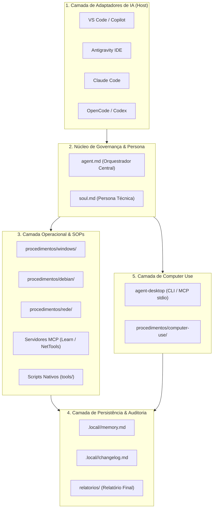

# Arquitetura do Brazilian Computer Guy (BCG)

Este documento detalha o modelo arquitetural, o ciclo de vida de um atendimento técnico e as fronteiras de isolamento de dados do **Brazilian Computer Guy**.

---

## 1. Visão Geral da Arquitetura

O BCG foi projetado sobre uma arquitetura desacoplada e modular, composta por 5 camadas essenciais:

---

## 2. Isolamento de Dados e Privacidade

1. **Repositório Template Neutro:**
   - O repositório distribuído no GitHub é totalmente agnóstico e isento de logs, caminhos ou históricos da máquina do desenvolvedor.
2. **Persistência Volátil e Isolada:**
   - Quando um computador é atendido, o agente instancia a pasta `.local/<nome-da-maquina>/`.
   - Essa pasta é ignorada pelo `.gitignore` e pertence exclusivamente à máquina atendida.
3. **Não Exposição de Segredos:**
   - O agente nunca transmite variáveis de ambiente sensíveis (`.env`), senhas ou tokens aos modelos de IA ou consultas documentais.

---

## 3. O Ciclo de Vida do Atendimento Técnico

Todo atendimento executado pelo BCG segue 6 fases bem delimitadas:
1. **Identificação do Ambiente:** Detecção de SO, versão, hostname e leitura da memória local prévia.
2. **Diagnóstico Somente Leitura:** Coleta de evidências usando SOPs e scripts sem alteração de estado.
3. **Proposta Técnica e Hipótese:** Formulação da causa raiz e proposta com comando exato e reversão.
4. **Consentimento Explícito (Opt-in):** Parada obrigatória aguardando aprovação explícita do técnico.
5. **Execução & Validação:** Aplicação do procedimento autorizado e teste antes/depois.
6. **Emissão de Relatório:** Geração do Relatório Técnico de Atendimento oficial para entrega e histórico.

---

## 4. Camada de Computer Use (agent-desktop)

A quinta camada usa o `agent-desktop`, do Vercel Labs (Apache-2.0), como ferramenta local de CLI e MCP stdio para observar a árvore de acessibilidade do sistema e agir por referências de elementos. O laço observar → agir → verificar permanece no agente e se subordina ao núcleo de governança, com registro de intervenções na camada de persistência e auditoria.

Sua finalidade é cobrir sintomas que só aparecem na interface gráfica, como diálogos de erro e aplicativos sem CLI, ou verificar visualmente uma intervenção. **O shell tem precedência:** quando existe caminho nativo, determinístico e auditável por linha de comando, ele é preferível; a GUI não o substitui.

A observação pertence à Classe A; ações de interface pertencem à Classe B e exigem Proposta de Intervenção aprovada; ações da Classe C continuam proibidas. Headless é o padrão, e `--headed` exige autorização separada para entrada física. Auditoria e relatórios registram evidências sanitizadas, nunca capturas privadas versionadas.

A camada **não cobre conteúdo de páginas de navegador** (usar ferramenta dedicada para o DOM), Session 0/SSH sem desktop interativo no Windows, secure desktop/UAC ou tela de login. Não deve ser tratada como acesso remoto irrestrito nem como desvio das comportas de autorização.

Contrato de operação, referências por snapshot, repetição segura e limites por plataforma: [`docs/computer-use.md`](./computer-use.md).
